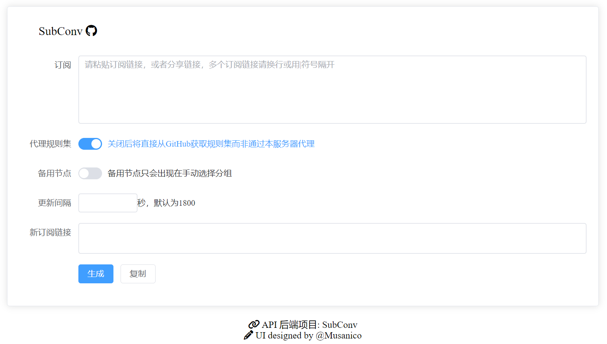

# Subscription Converter

English | [中文](README_CN.md)

 

This project is a subscription converter aiming to transform subscriptions into mihomo-compatible configs.

We ship two built-in templates in the root `template/` directory: `zju.yaml` and `general.yaml`. The Web UI defaults to `zju`, and the API does the same when the `template` query parameter is omitted. The repository includes `config.yaml.example` as the default runtime config.

Outbound requests reject private networks by default, including redirect targets. Set `ALLOW_PRIVATE_NETWORKS: true` in `config.yaml` only when your deployment needs internal subscriptions or rules. Requests connect directly and do not use proxy environment variables.

## Screenshot



## Features

- Support Clash config and V2ray format base64 links (i.e. the original subscription does not have to be Clash)
  - Share-link parsing follows mihomo, including Hysteria2 port hopping/Realm, Reality ML-KEM options, and XHTTP extra settings.
  - HTTP/SOCKS credentials accept plaintext or Base64; URL credentials decode percent escapes according to mihomo's rules, node names preserve literal `+`, and VMess AEAD honors `packetEncoding` and uses the first `encryption` value when repeated, matching mihomo.
  - Hysteria/Trojan TLS flags follow Go's boolean parsing: `t`/`T` are true; invalid values such as `yes` are false.
  - Invalid share links fail conversion with a clear error instead of silently dropping nodes; blank lines and `#` metadata comments are ignored. YAML anchors and merge keys are supported. Each parsed subscription is limited to 10,000 proxies and 10 MiB of expanded scalar fields.
- A Web-UI (thanks to [@Musanico](https://github.com/musanico))
- Rules based on ACL
- Nodes auto update based on proxy-provider
- Rules auto update based on rule-provider
- Support proxy rule-provider to prevent failure to get rules from GitHub
- Support multiple airports
- Display remaining traffic and total traffic (only useful when you use a single airport, requires your airport and Clash to support it at the same time, Clash for Windows, Clash Verge, Stash, Clash Meta for Android, etc. are known to support it)
- Implement the api of subscription conversion to proxy-provider (normal people won't use it)
- Support template files

## Docs

[docs](https://subconv.is-sb.com) (both Chinese and English, but machine translated)

## Repo Layout

- `subconv/`: FastAPI backend and converter logic
- `api.py`: thin entrypoint used by the CLI and Vercel
- `config.yaml.example`: example runtime config; put user changes in `config.yaml`
- `template/`: runtime YAML templates (`zju.yaml` is the default, `general.yaml` is the alternate)
- `mainpage/`: Vue/Vite frontend
- `docs/`: VitePress documentation site, deployed separately via GitHub Pages

Local commands (requires [uv](https://docs.astral.sh/uv/) and [bun](https://bun.sh)):

- Backend: `uv sync`, optionally copy `config.yaml.example` to `config.yaml` (recommended; the bundled `docker-compose.yml` requires it), edit it if needed, then `uv run python api.py`
- Frontend: `cd mainpage && bun install && bun run dev`
- Docs: `cd docs && bun install && bun run dev`

## P.S

**Clash Core from Dreamacro** (original Clash core) is no longer supported. It's recommended to use [mihomo](https://github.com/MetaCubeX/mihomo) instead.

## Usage

Deploy by yourself according to [docs](https://subconv.is-sb.com)

## Contribute

Welcome issue and PR. If you want to contribute, please create a new branch from main and then create a PR to dev, or you can merge main into dev first and then make changes in dev, and finally create a PR to dev branch.

Run the converter tests locally (no network access is needed during the tests):

```bash
uv sync --locked --group test
uv run --no-sync python -m pytest tests/
```

CI runs these tests on Python 3.13 when backend code, tests, or Python dependencies change.

## Credits

- [subconverter](https://github.com/tindy2013/subconverter)
- [mihomo](https://github.com/MetaCubeX/mihomo)
- ~~[Proxy Provider Converter](https://github.com/qier222/proxy-provider-converter)~~

## License

This project is distributed under [MPL-2.0 License](https://github.com/SubConv/SubConv/blob/main/LICENSE)
